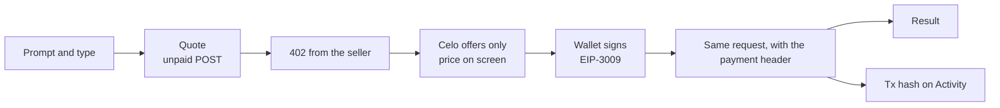
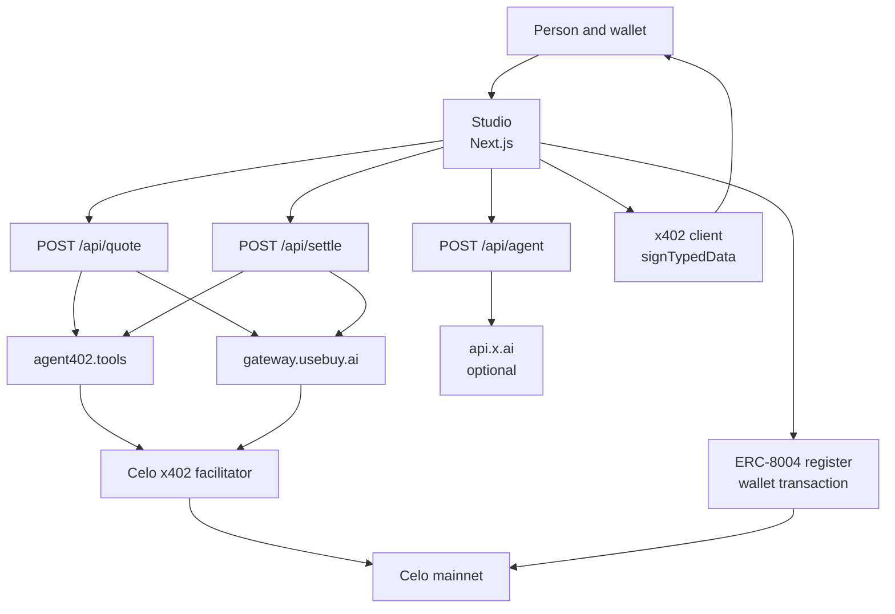

# Flux

**Ask for an image, a clip, a voice, or a song. Pay for it on Celo before it comes back.**

Flux is a studio for the Celo Agents on Open Rails hackathon, on the Build with buy track. You write a prompt, Flux fetches a live price from the service that will do the work, and your wallet signs a stablecoin authorization. The result appears after that payment settles. The app keeps the transaction hash so a judge can open it on Celoscan.

The public app is [https://flux.mattt-dreamer.workers.dev](https://flux.mattt-dreamer.workers.dev). A payment counts when a connected wallet produces a hash. This deploy does not include a settlement.

- **Track:** Build with buy, [Agents on Open Rails](https://www.loops.house/agents-on-open-rails)
- **Chain:** Celo mainnet, chain id `42220`
- **Judge path:** [How a judge checks a payment](#how-a-judge-checks-a-payment)

---

## Contents

- [The problem](#the-problem)
- [What Flux does](#what-flux-does)
- [How a purchase works](#how-a-purchase-works)
- [Architecture](#architecture)
- [What gets paid](#what-gets-paid)
- [What the agent does, and what it never does](#what-the-agent-does-and-what-it-never-does)
- [Guarantees](#guarantees)
- [Screens](#screens)
- [Identity and attribution](#identity-and-attribution)
- [Contracts](#contracts)
- [Running it yourself](#running-it-yourself)
- [How a judge checks a payment](#how-a-judge-checks-a-payment)
- [Testing](#testing)
- [Project layout](#project-layout)
- [Known limitations](#known-limitations)

---

## The problem

Generative tools hide the bill. A button says Generate, a vendor key on a server pays for the call, and the person who asked has no receipt and no choice of stablecoin. On Celo the rails already exist: a service can answer `402` with a price in USDC, USD₮, or USA₮, and a wallet can authorize that exact amount. Most demos still skip the signature and return a canned file.

Flux is the other shape. The price is on screen before the wallet opens. The signature is the payment. The picture, the clip, the voice, or the score comes back with a transaction hash.

## What Flux does

Flux buys four kinds of work. Three of them are media. One of them is a composition, and the vocal that follows it is a second purchase.

The product rests on one boundary:

> The person signs every payment. The model never does, and the server never holds a key.

While this app was being built, unpaid quotes against the live services returned:

| Request | What the 402 said | Payee |
| --- | --- | --- |
| Voice, “hello flux” | `6000` USDC on `eip155:42220` ($0.006) | `0xaBF4FAbd7c416fB67202E5f9002389Fc75e2a9D0` |
| Image | `30000` USDC on `eip155:42220` ($0.03) | same agent402 payee |
| Music, the score | `10000` in USDC, USD₮, and USA₮ on network `celo` ($0.01) | `0x20faAca5F980E29639A0FCC6dcA6988E18ed333B` |

Those rows are quotes, not settlements. The app stores an Activity row only after a settlement header contains a transaction hash. Nothing in this repository was paid for in advance.

## How a purchase works



1. **Connect a wallet on Celo.** MetaMask and MiniPay work as injected wallets. WalletConnect needs `NEXT_PUBLIC_WALLETCONNECT_PROJECT_ID`. If the wallet is on another chain, Flux asks it to switch to chain id `42220` before it quotes.
2. **Write a prompt and pick a type.** Image, video, music, or voice. The studio builds one request from that pair. The browser does not get to name the URL.
3. **Ask for the price.** `POST /api/quote` sends the unpaid request. A `200` with a free result is rejected. Flux will not display an unpaid file as a purchase.
4. **Read the quote.** The panel shows the amount, the token, the payee, and the network. If the 402 lists more than one Celo asset, you pick among those. Nothing is signed yet.
5. **Approve and generate.** The official x402 client signs one chosen accept. Image, video, and voice use a v2 `PAYMENT-SIGNATURE` header. buy.ai uses a v1 `X-PAYMENT` header. The facilitator submits the settlement and pays that transaction’s gas.
6. **Wait for the same request.** `POST /api/settle` repeats the prompt and type, rebuilds the body, and attaches the header you just signed. Flux does not retry a paid call. If the call times out, check Celoscan before you sign again. A second signature can pay twice.
7. **Keep the receipt.** The result renders in the studio. Activity records the hash, the payer, the payee, the token, and the amount.

Music adds a second lap. The first settlement is a score from buy.ai: title, tempo, key, lyrics, and one line meant to be spoken. **Price the vocal** quotes that line as voice. That second quote is its own signature. The score can settle in USDC, USD₮, or USA₮. The vocal service, on the quotes seen so far, lists USDC.

## Architecture

The Next.js app is the only server. It proxies two hosts and nothing else. The browser holds the wallet. The sellers and the Celo facilitator do the rest.



Quote and settle run in route handlers. They refuse a redirect, they cap the body, and they forward only `PAYMENT-SIGNATURE` or `X-PAYMENT`. The signer receives a `PaymentRequired` that contains the single Celo accept you selected, so a Base quote sitting earlier in the same 402 cannot be chosen by accident.

### Where each rail fits

| Rail | What it does in Flux | Where |
| --- | --- | --- |
| **buy.ai** | Prices and settles the composition on Celo in USDC, USD₮, or USA₮, whichever the live 402 lists | `lib/modalities.ts`, `app/api/quote/route.ts` |
| **agent402** | Prices and settles image, video, and voice on Celo. Quotes seen so far accept USDC | `lib/modalities.ts` |
| **x402 client** | Builds the EIP-3009 authorization and the versioned payment header | `lib/pay.ts` |
| **Celo facilitator** | Submits the settlement. Flux does not call `/settle` itself and does not hold a facilitator key | The seller’s 402 flow |
| **ERC-8004** | Registers this studio as an agent NFT when you ask it to | `app/settings/page.tsx`, `lib/identity.ts` |
| **ERC-8021** | Appends an attribution suffix to the registration and URI update, which the wallet sends | `lib/attribution.ts` |
| **Grok** | Optional planner on the Agent page. `grok-4.7` through `https://api.x.ai/v1/responses` | `app/api/agent/route.ts` |

## What gets paid

| Request | Seller | Request | What comes back |
| --- | --- | --- | --- |
| Image | agent402 | `POST /api/image-gen` with `{ prompt }` | An image |
| Video | agent402 | `POST /v1/videos/generations` with `{ prompt, aspect_ratio: "16:9" }` | A short clip |
| Voice | agent402 | `POST /api/tts` with `{ text, voice: "alloy", format: "mp3" }` | Speech. The text is cut at 280 characters |
| Music, step 1 | buy.ai Cencori `maximo-atlas-1.3` | `POST /cencori/v1/chat/completions` | A score as JSON: title, bpm, key, lyrics, vocal |
| Music, step 2 | agent402 text to speech | The vocal line from that score | The line, spoken |

buy.ai’s public catalog does not sell image, video, music, or voice generation. Flux does not send those jobs to a private model key and label the result as an x402 purchase. The price on screen is the `maxAmountRequired` or `amount` in the 402 for that exact body.

The token picker lists only assets in that response. Local stables such as wARS can be signed if a future quote names them. They are not offered as a default, because the quotes above did not list them.

A USDC, USD₮, or USA₮ quote above $1 is refused before the wallet opens. Video at the flat prices seen while building sits under that cap. A runaway quote does not.

## What the agent does, and what it never does

The Agent page is a planner. You describe what you want. It answers with one modality, one prompt, and a link into the studio. You still see the quote, and you still sign.

| Job | Input | Output | Guard |
| --- | --- | --- | --- |
| Plan a generation | The last few messages | `image`, `video`, `music`, or `voice`, plus a prompt | Any other modality is dropped. The planner cannot name a URL |
| Fall back | The same text, with no API key or a failed call | A plan from the wording, labelled as such | The page says the plan did not come from Grok |
| Compose, when you pay | Your music prompt, sent to Cencori | The score JSON | This call is a purchase. It is not the Agent page |
| Speak, when you pay | The vocal line, sent to agent402 | Audio | A second signature |

Grok runs only when `XAI_API_KEY` is set, and only on the server. Without the key, Flux plans from the words in the request and tells you so. The agent never sees a payment header and never calls quote or settle for you.

## Guarantees

Each of these is in the request path. The offer filter, the receipt parser, the planner, and both payment-header versions are covered by `npm test`. The header tests sign with a public test key and do not broadcast.

| Guarantee | How | Where |
| --- | --- | --- |
| A Base quote cannot be signed by accident | Only `celo` and `eip155:42220`, scheme `exact`. Batched gateway offers are dropped. The signer is given one accept | `lib/offers.ts`, `lib/pay.ts` |
| The wallet signs the price on screen | Amount, payee, asset, network, and scheme must match the raw accept | `lib/pay.ts` |
| A dollar quote cannot exceed $1 | USDC, USD₮, and USA₮ above `1000000` atomic units are rejected. The x402 client has the same cap | `lib/offers.ts`, `lib/pay.ts` |
| The proxy is not an open proxy | HTTPS only, host must be `gateway.usebuy.ai` or `agent402.tools`, no userinfo, no odd port, redirects stopped | `lib/hosts.ts`, `lib/upstream.ts` |
| Settle cannot forward an arbitrary header | Only `PAYMENT-SIGNATURE` and `X-PAYMENT` | `app/api/settle/route.ts` |
| A paid call is not retried | One attempt. A timeout tells you to check Celoscan before signing again | `app/api/settle/route.ts` |
| A free response is not called a purchase | Quote requires HTTP 402. Activity requires a 32-byte transaction hash | `app/api/quote/route.ts`, `components/studio.tsx` |
| The server cannot spend | No private key and no facilitator API key in the app. The browser signs | `lib/pay.ts` |
| The planner cannot invent a seller | Modality must be one of the four. The server rebuilds the seller request from modality and prompt | `lib/plan.ts`, `lib/modalities.ts` |

## Screens

| Route | What it is for |
| --- | --- |
| `/` | The mark, the pitch, and **Start generating** |
| `/studio` | Prompt, type, **Get price**, the quote, **Approve and generate**, and the result |
| `/activity` | Settlements stored in this browser, each with a Celoscan link |
| `/agent` | A plan, then a link that opens the studio with the prompt filled in |
| `/settings` | Wallet, preferred stablecoin, attribution code, and **Register on Celo** |
| `/agent-registration.json` | The ERC-8004 registration file for this origin |
| `/.well-known/agent-card.json` | A small agent card. Flux’s own routes do not accept x402, so `x402Support` is false |

Activity is local to the browser. It is a record of hashes, not a second source of truth. Celoscan is the source of truth.

## Identity and attribution

Settings can register Flux on the ERC-8004 Identity Registry. `register(agentURI)` mints the agent NFT to the connected wallet and sets that wallet as the agent wallet. The agent id is read from the `Registered` event on the receipt, not from the value a simulation would have returned.

The registration file is `{origin}/agent-registration.json`. Register from a public HTTPS origin. A localhost URI is a poor thing to write on mainnet. After you have an id, set `NEXT_PUBLIC_AGENT_ID` so the file’s `registrations` entry matches the chain. Until then the file is published without that entry, which is what the spec expects before the id exists.

The registration and a later `setAgentURI` append an ERC-8021 suffix from `@celo/attribution-tags`. The default code is `codeFromHostname("flux.celo.app")`. Set `NEXT_PUBLIC_ATTRIBUTION_TAG` to use another code. You can pay the registration gas in CELO, or check **Pay registration gas in USDC** to use the USDC fee-abstraction adapter `0x2F25deB3848C207fc8E0c34035B3Ba7fC157602B`. That adapter is not the EIP-3009 USDC token.

x402 settlement transactions are submitted by the facilitator. They do not carry the attribution suffix yet. For those payments the proof is the buyer address, the payee, and the hash in `PAYMENT-RESPONSE`. Flux shows that hash on the result and on Activity.

## Contracts

Celo mainnet, chain id `42220`.

| Record | Address |
| --- | --- |
| ERC-8004 Identity Registry | `0x8004A169FB4a3325136EB29fA0ceB6D2e539a432` |
| ERC-8004 Reputation Registry | `0x8004BAa17C55a88189AE136b182e5fdA19dE9b63` |
| USDC, EIP-3009, 6 decimals, name `USDC`, version `2` | `0xcebA9300f2b948710d2653dD7B07f33A8B32118C` |
| USD₮, EIP-3009, 6 decimals, name `Tether USD`, version `1` | `0x48065fbBE25f71C9282ddf5e1cD6D6A887483D5e` |
| USA₮, EIP-3009, 6 decimals, name `Tether America USD`, version `1` | `0xD2ab3C9A02DBBAB236BfEC45D1d755DF4267F771` |

The payee on screen is the payee in the live quote. On 2026-11-01, buy.ai quotes named `0x20faAca5F980E29639A0FCC6dcA6988E18ed333B` and agent402 quotes named `0xaBF4FAbd7c416fB67202E5f9002389Fc75e2a9D0`.

Flux does not ship with an agent id. Yours appears after you register.

## Running it yourself

```bash
npm install
cp .env.example .env.local
npm run dev
```

Open http://localhost:3000.

Deploy the same app to Cloudflare Workers. Wrangler 4 needs Node.js 22.

```bash
npx wrangler login
npm run deploy
```

`npm run deploy` builds with OpenNext and uploads the Worker named `flux`. The account id is pinned in `wrangler.jsonc`. The current deployment is [https://flux.mattt-dreamer.workers.dev](https://flux.mattt-dreamer.workers.dev). Do not commit `.dev.vars` or an API key. If you want the Agent page to call Grok, set the secret with `npx wrangler secret put XAI_API_KEY`.

| Variable | Required | What it does |
| --- | --- | --- |
| `NEXT_PUBLIC_WALLETCONNECT_PROJECT_ID` | No | Turns on WalletConnect. Injected wallets work without it |
| `NEXT_PUBLIC_CELO_RPC` | No | Defaults to `https://forno.celo.org` |
| `NEXT_PUBLIC_ATTRIBUTION_TAG` | No | Replaces the default ERC-8021 code |
| `NEXT_PUBLIC_AGENT_ID` | No | Writes your agent id into the registration file after you register |
| `XAI_API_KEY` | No | Lets the Agent page ask Grok. Server only. Never put it in the browser |

Fund the wallet with a little CELO if you will register an identity, and with USDC for media. Add USD₮ or USA₮ if you want that choice on the buy.ai score. The preferred token in Settings is used when a quote lists more than one asset. It defaults to USA₮.

## How a judge checks a payment

The public origin is [https://flux.mattt-dreamer.workers.dev](https://flux.mattt-dreamer.workers.dev).

1. Connect a Celo wallet and open Studio.
2. Use a short prompt. Voice and image are the small purchases. Video is a larger flat quote and can take a few minutes.
3. Choose **Get price**. Confirm the amount, the token, the payee, and Celo. Nothing has been signed.
4. Choose **Approve and generate** and sign. That signature is an EIP-3009 authorization. You are not sending a token transfer yourself.
5. When the result appears, open the transaction on [Celoscan](https://celoscan.io). The payer on Activity is the connected wallet. The payee should match the quote.
6. For music, the first result is the score. **Price the vocal** is a second payment. Judge them as two settlements.
7. For the agent identity, register from Settings on that HTTPS origin, and open the id on [8004scan](https://8004scan.io/agents/celo/). The registration input ends with the attribution suffix.

If a paid call times out, do not sign again until Celoscan shows whether the first authorization settled.

## Testing

```bash
npm test
npm run lint
npm run build
```

`npm test` covers the Celo offer filter, the buy.ai v1 body, receipt decoding, image and composition parsing, the planner’s refusal of an unknown modality, and live-shaped payment headers for USA₮ on v1 and USDC on v2. Signing uses a well-known local test key. It does not broadcast, and it does not spend.

## Project layout

| Path | What it holds |
| --- | --- |
| `app/page.tsx` | Landing |
| `app/studio/page.tsx`, `components/studio.tsx` | The purchase |
| `app/activity/page.tsx` | Local receipts |
| `app/agent/page.tsx`, `app/api/agent/route.ts` | The planner |
| `app/settings/page.tsx` | Wallet, token, identity |
| `app/api/quote/route.ts`, `app/api/settle/route.ts` | The allowlisted proxy |
| `lib/modalities.ts` | The only place a seller request is built |
| `lib/offers.ts` | Which 402 accepts are eligible |
| `lib/pay.ts` | Signing |
| `lib/hosts.ts`, `lib/upstream.ts` | The host boundary and the single attempt |
| `lib/identity.ts`, `lib/attribution.ts` | ERC-8004 and the suffix |
| `lib/*.test.ts` | The checks above |

## Known limitations

- There is no single music model in this flow. A song is a paid score plus a paid vocal, and the screen says so.
- Quotes probed while building listed USDC for media and USDC, USD₮, and USA₮ for the score. The picker cannot offer a token the 402 did not name.
- Facilitator settlements are not tagged with ERC-8021. Attribution is on the identity transaction the wallet sends.
- The repository does not contain an agent id or a pre-recorded settlement. Both require a wallet.
- Video responses are large and slow. The public app runs on Cloudflare Workers. Unpaid voice and music quotes succeeded there. A video settle can run for minutes, and if the Worker cuts that request off you can have a settlement and no file. Check the hash before you try again.
- The $1 ceiling is deliberate. Raise it in `lib/celo.ts` and in the spend controls in `lib/pay.ts` together if a seller’s real price outgrows it.
- WalletConnect stays off until a project id is set. That is a Cloud project id, not a key that can spend.
- Activity lives in `localStorage` under `flux.activity.v1`. Another browser, or a cleared site data, starts the list over. The chain does not.
